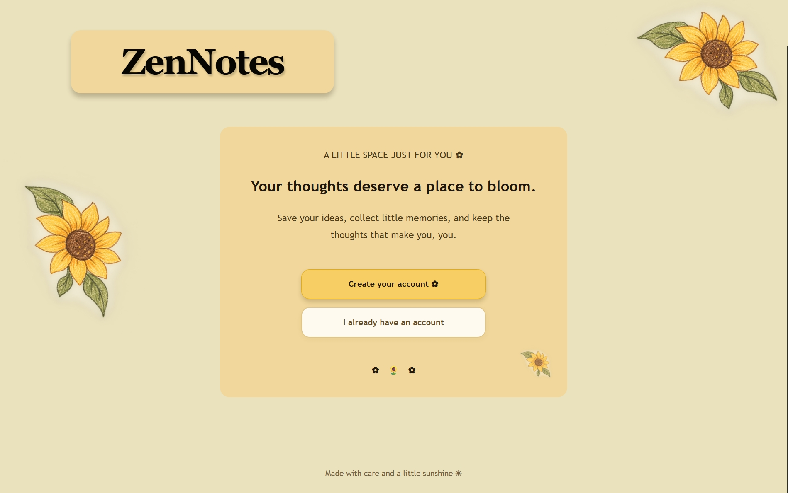

# 🌻 ZenNotes — A Little Space for Your Thoughts

A cozy, full-stack note-taking web application built with **Python, Flask, SQLite, HTML, CSS, and JavaScript**. ZenNotes helps users organize their thoughts in a simple, personal space with a warm sunflower-inspired interface.

## 📸 Preview



## ✨ Features

- **User Authentication:** Sign up, log in, and log out securely, with password hashing.
- **Create and Manage Notes:** Create, view, edit, and delete personal notes.
- **Pin Important Notes:** Keep pinned notes at the top of the dashboard.
- **Favorites:** Mark notes as favorites and filter your favorite collection.
- **Search:** Find notes by searching their titles and content.
- **Categories:** Organize notes into Personal, College, Ideas, Work, or custom categories.
- **Category Filtering:** View notes belonging to a selected category.
- **Database Persistence:** Store user accounts and notes using SQLite.
- **CSRF Protection:** Protect form submissions using Flask-WTF.
- **Sunflower-Inspired UI:** A warm, welcoming interface with custom styling and floral details.

## 🛠️ Tech Stack

| Technology | Purpose |
|---|---|
| Python | Backend application logic |
| Flask | Web framework and routing |
| SQLite | Database for users and notes |
| HTML | Page structure |
| CSS | Styling and visual design |
| JavaScript | Interactive dashboard elements |
| Flask-WTF | CSRF protection |
| python-dotenv | Loading environment variables |

## Getting Started

### Prerequisites

- Python 3
- Git
- A GitHub account (optional, for version control and collaboration)

### 1. Clone the repository

```bash
git clone https://github.com/harshitamallik09/ZenNotes.git
cd ZenNotes
```

### 2. Create and activate a virtual environment

**Windows PowerShell:**

```powershell
python -m venv .venv
.venv\Scripts\Activate.ps1
```

### 3. Install dependencies

```bash
python -m pip install -r requirements.txt
```

### 4. Configure environment variables

Create a `.env` file in the project root, in the same folder as `app.py`.

Generate a secret key by running:

```bash
python -c "import secrets; print(secrets.token_hex(32))"
```

Copy the generated value into `.env`:

```text
SECRET_KEY=your-generated-secret-key
```

Replace the example value with your generated key. Keep `.env` private and never commit it to GitHub.

### 5. Run the application

```bash
python app.py
```

Open the local address shown in your terminal in your browser. On the usual local Flask configuration, this is `http://127.0.0.1:5000/`.

The application initializes its SQLite database when it starts.

## 📁 Project Structure

```text
ZenNotes/
├── app.py
├── requirements.txt
├── .gitignore
├── README.md
├── static/
│   ├── style.css
│   └── images/
│       └── sunflower-doodle.png
└── templates/
    ├── welcome.html
    ├── signup.html
    ├── login.html
    ├── index.html
    ├── add_note.html
    ├── view_note.html
    └── edit_note.html
```

## 🔐 Security Notes

- Passwords are stored as hashes rather than plain text.
- Form submissions use CSRF protection.
- Notes are associated with user accounts.
- The secret key and local database are excluded from version control through `.gitignore`.

Use a unique secret key for your local environment. Before deploying the application publicly, configure production settings and review the application's deployment security.

## 🌱 Future Improvements

- Add note reminders and deadlines.
- Add richer text editing and formatting.
- Add note export and backup functionality.
- Deploy the application so it can be accessed online.

## 👩‍💻 Built With

**ZenNotes** was developed as a hands-on project to practice backend development, database integration, authentication, and interactive web development using Flask.

---

*Made with care and a little sunshine ☀️*